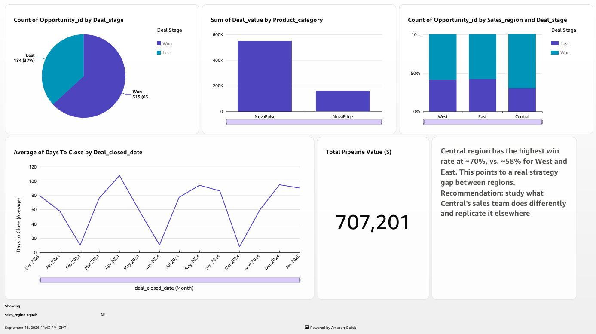
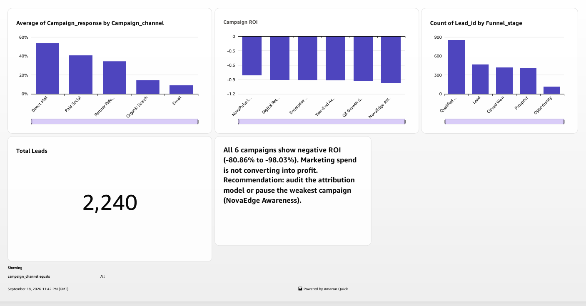
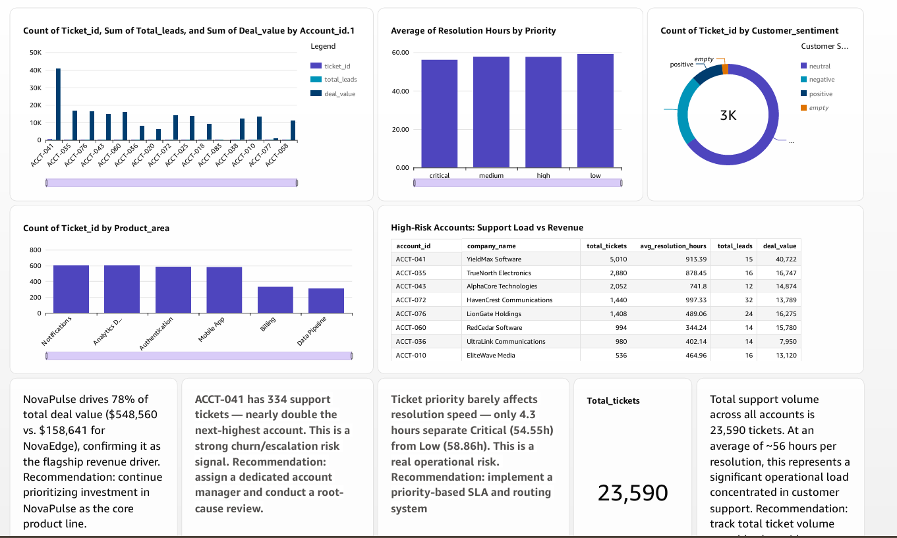

# NovaTech Revenue Intelligence Dashboard

## Project Overview
An interactive Business Intelligence project designed to explore revenue-related business data across CRM sales opportunities, marketing funnel performance, and customer support activity.

The project uses Amazon QuickSight to organize business data into visual dashboards that support performance monitoring, exploratory analysis, and data-driven decision-making.

## Business Objectives
- Analyze CRM sales opportunities and deal outcomes.
- Explore marketing funnel stages and lead distribution.
- Review customer support ticket sentiment.
- Identify potential data-quality issues and opportunities for further investigation.
- Present business information through interactive visualizations.

## Data Sources
The project includes three main datasets:
- **CRM Deals:** Sales opportunities and deal outcomes.
- **Marketing Campaigns:** Marketing funnel and lead-stage information.
- **Customer Support Tickets:** Support activity and sentiment information.

## Dashboard Components
1. **Sales Pipeline:** Analysis of CRM opportunities and Won/Lost outcomes.
2. **Marketing Funnel:** Distribution of records across lead and opportunity stages.
3. **Customer Health & Support:** Overview of support ticket records and sentiment categories.

## Tools & Technologies
- Amazon QuickSight
- Business Intelligence (BI)
- Data Visualization
- Exploratory Data Analysis
- Data Quality Assessment
- AI-assisted analytical workflows

## Data Quality & Validation
The project also considers data completeness, missing values, and the reliability of business metrics. Any suspected data-quality issue should be validated against the underlying dataset before being reported as a confirmed finding.

## Future Improvements
- Add validated KPIs and documented business findings.
- Include dashboard screenshots and supporting evidence.
- Document data-cleaning and validation steps.
- Improve metric definitions and analytical recommendations.

## Project Status
Dashboard exploration and documentation are in progress. Findings and metrics should be interpreted within the scope of the available data and verified analysis.

## Author
Abdul Rahman Mohsen
## Dashboard Screenshots

### Sales Pipeline

### Marketing Funnel

### Customer Health & Support

